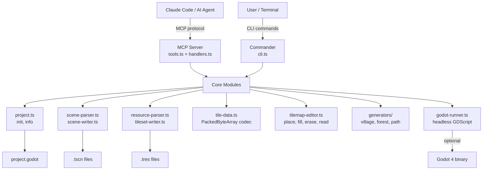

# godot-map-cli

**CLI + MCP server for AI-driven Godot 4 TileMap editing**

[](https://nodejs.org/)
[](LICENSE)
[](https://www.typescriptlang.org/)

Create, inspect, and programmatically edit Godot 4 TileMap scenes. Supports both CLI and MCP protocol for integration with Claude Code and other AI agents.

## Features

- Create and inspect Godot 4 projects with standard RPG structure
- Generate TileSets from PNG images with physics layers, terrains, and collision support
- Create scenes with multiple TileMapLayers
- Place, fill, erase, and read tiles using binary PackedByteArray format
- ASCII-render tilemaps directly in the terminal
- Procedural generators with seeded RNG: village, forest, path
- Headless Godot integration for terrain autotiling and screenshots
- MCP server with 24 tools for Claude Code integration
- Zero runtime dependencies beyond MCP SDK and Commander

## Installation

### Global

```bash
npm install -g godot-map-cli
godot-map-cli --help
```

### As npx

```bash
npx godot-map-cli --help
```

## Quick Start

### Create a project

```bash
godot-map-cli init my-rpg --name "My RPG"
cd my-rpg
```

### Create a tileset from PNG

```bash
godot-map-cli tileset create overworld \
  --image assets/tileset.png \
  --tile-size 16 \
  --project .
```

### Create a scene with layers

```bash
godot-map-cli map create scenes/world.tscn \
  --tileset res://tilesets/overworld.tres \
  --layers Ground,Buildings,Details
```

### Place tiles

```bash
godot-map-cli map place scenes/world.tscn \
  --layer Ground \
  --at 5,5 \
  --tile 0,0
```

### Fill an area

```bash
godot-map-cli map fill scenes/world.tscn \
  --layer Ground \
  --rect 0,0,20,20 \
  --tile 0,0
```

### Render to terminal

```bash
godot-map-cli map render scenes/world.tscn --layer Ground
```

### Generate a village

```bash
godot-map-cli generate village scenes/world.tscn \
  --center 10,10 \
  --size 20,20 \
  --houses 5 \
  --seed 42
```

## CLI Reference

### Project Management

| Command | Description |
|---------|-------------|
| `init <path>` | Create a new Godot 4 project with RPG structure |
| `info [path]` | Show project metadata (scene count, scripts, assets) |
| `godot-version` | Display detected Godot installation and version |

### TileSet Management

| Command | Description |
|---------|-------------|
| `tileset create <name>` | Create TileSet from PNG image |
| `tileset inspect <path>` | Parse and display TileSet structure |
| `tileset register-tiles <path>` | Register tile definitions in TileSet |
| `tileset set-collision <path>` | Add collision polygon to tile |
| `tileset add-terrain <path>` | Add terrain set with named terrains |

### Map Editing

| Command | Description |
|---------|-------------|
| `map create <scene>` | Create scene with TileMapLayers |
| `map list [project]` | List all tilemaps in a project |
| `map info <scene>` | Get tilemap layer metadata |
| `map place <scene>` | Place a single tile |
| `map fill <scene>` | Fill rectangle with tile |
| `map read <scene>` | Read tiles from layer |
| `map render <scene>` | ASCII-render layer to terminal |
| `map erase <scene>` | Erase tiles by position or rectangle |
| `map remove-layer <scene>` | Remove TileMapLayer from scene |

### Procedural Generation

| Command | Description |
|---------|-------------|
| `generate village <scene>` | Generate village with houses and paths |
| `generate forest <scene>` | Generate forest with clustered trees |
| `generate path <scene>` | Generate path between two points |

### Headless Godot (Requires Installation)

| Command | Description |
|---------|-------------|
| `render <scene>` | Render scene to PNG using headless Godot |
| `terrain-resolve` | Resolve terrain autotiling with headless Godot |

### MCP Server

| Command | Description |
|---------|-------------|
| `mcp` | Run as MCP server for Claude Code integration |

## Architecture



Both CLI and MCP server share the same core modules. The MCP server exposes operations as tools for AI agents, while the CLI provides the same functionality for terminal users.

## MCP Server Setup

### Build

```bash
npm run build
```

### Configure for Claude Code

Add a `.mcp.json` file to your project root (or `~/.mcp.json` for global access):

```json
{
  "mcpServers": {
    "godot-map-cli": {
      "command": "node",
      "args": ["/path/to/godot-map-cli/dist/mcp-server.js"]
    }
  }
}
```

Set `GODOT_PROJECT_PATH` env var to default to a specific project directory.

### Available Tools

| Tool | Description |
|------|-------------|
| `godot_project_init` | Create new Godot 4 project with standard directory structure |
| `godot_project_info` | Get project metadata (name, scene count, script count) |
| `godot_tileset_create` | Create TileSet from PNG with optional physics layer |
| `godot_tileset_inspect` | Parse TileSet .tres and return full structure |
| `godot_tileset_register_tiles` | Register tile definitions in TileSet |
| `godot_tileset_set_collision` | Add collision polygon to tile |
| `godot_tileset_add_terrain` | Add terrain set with named terrains |
| `godot_scene_create` | Create scene with TileMapLayer nodes |
| `godot_layer_add` | Add TileMapLayer to existing scene |
| `godot_layer_remove` | Remove TileMapLayer from scene |
| `godot_tilemap_list` | Scan project for all TileMapLayer nodes |
| `godot_tilemap_info` | Get TileMapLayer metadata (bounds, tile count, z-index) |
| `godot_tilemap_read` | Read tiles from layer with optional region filter |
| `godot_tilemap_render` | ASCII-render layer (source or atlas mode) |
| `godot_tilemap_set_tiles` | Place/overwrite tiles on layer |
| `godot_tilemap_fill_rect` | Fill rectangular area with tile |
| `godot_tilemap_erase_tiles` | Remove tiles at specific positions |
| `godot_tilemap_erase_rect` | Clear all tiles in rectangular area |
| `godot_generate_village` | Generate village layout with houses and paths |
| `godot_generate_forest` | Generate forest with clustered trees |
| `godot_generate_path` | Generate path between two points |
| `godot_terrain_resolve` | Resolve terrain autotiling (requires Godot) |
| `godot_render_screenshot` | Render scene to PNG (requires Godot) |

## Development

### Setup

```bash
git clone https://github.com/yourusername/godot-map-cli
cd godot-map-cli
npm install
```

### Build

```bash
npm run build
```

### Watch Mode

```bash
npm run dev
```

### Test

```bash
npm test
npm run test:watch
```

### Start MCP Server

```bash
npm run start:mcp
```

### Start CLI

```bash
npm run start:cli -- --help
```

## How It Works

### File Format Handling

- Reads and writes Godot 4 `.tscn` (text scene) files directly
- Parses and generates `.tres` (resource) files for TileSets
- Encodes/decodes Godot's `PackedByteArray` binary format for tile data
- No AST transformation - preserves formatting and comments

### Godot Integration

- 90% of operations require no Godot installation
- Headless Godot used only for:
  - Terrain autotiling resolution
  - Screenshot rendering
- Godot detection via `GODOT_PATH` environment variable or system PATH

### Procedural Generation

- All generators use seeded RNG for reproducibility
- Deterministic output with same seed always produces same layout
- Supports variable density and size parameters

### Binary Data

- Tiles stored as `PackedByteArray` in Godot format
- Each cell encoded as: source_id (8 bits), atlas_x (16 bits), atlas_y (16 bits), alt (4 bits)
- Automatic packing/unpacking - transparent to user

## Examples

### Create a complete RPG world

```bash
# Initialize project
godot-map-cli init my-game --name "My RPG"
cd my-game

# Create tileset
godot-map-cli tileset create terrain --image ../assets/terrain.png --tile-size 16

# Create world scene
godot-map-cli map create scenes/world.tscn \
  --tileset res://tilesets/terrain.tres \
  --layers Ground,Obstacles,Decoration

# Generate base terrain
godot-map-cli map fill scenes/world.tscn \
  --layer Ground \
  --rect 0,0,100,100 \
  --tile 0,0

# Add village
godot-map-cli generate village scenes/world.tscn \
  --center 50,50 --size 30,30 --houses 8

# Add forest
godot-map-cli generate forest scenes/world.tscn \
  --rect 70,20,20,20 --density 0.7
```

### Use with Claude Code

```
User: "Create a dungeon layout with rooms connected by corridors"

Claude Code:
  1. godot_scene_create with Ground, Walls, Decoration layers
  2. godot_tilemap_fill_rect to create room areas
  3. godot_generate_path to connect rooms with corridors
  4. godot_tilemap_read to inspect layout
  5. godot_render_screenshot to visualize
```

## Requirements

- Node.js >= 20
- Optional: Godot 4.x (for terrain autotiling and screenshots)

## License

MIT

## Contributing

Contributions welcome! Please:

1. Test all code changes
2. Maintain TypeScript strict mode
3. Keep functions under 20 lines
4. Add tests for new features
5. Update documentation

## Support

- Report issues on GitHub
- Check existing issues first
- Include your Godot version and project structure
